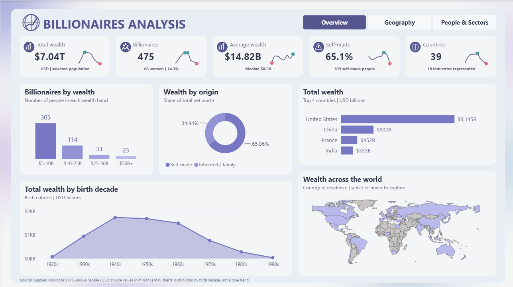
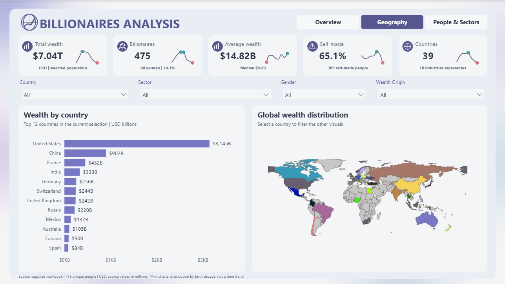

# Billionaires Analysis Dashboard

## Project Overview

This project is an interactive dashboard built with **Power BI** to analyze the world's billionaires. It explores how wealth is distributed across countries, industries, wealth origin (self-made vs. inherited), gender, and birth decade.

The dashboard is organized into three pages (Overview, Geography, and People & Sectors) with interactive filters and visuals that update together. The project is published and version-controlled on **GitHub**.

---

## Dashboard Link

🔗 **[Open the Interactive Billionaires Dashboard](https://app.powerbi.com/view?r=eyJrIjoiZWVkNjU4OTAtOWQxMy00Zjk2LWJlMjUtYzJjYTYzZjI3ZDM2IiwidCI6IjJiYjZlNWJjLWMxMDktNDdmYi05NDMzLWMxYzZmNGZhMzNmZiIsImMiOjl9)**

---

## Dataset

- **Source:** A supplied workbook containing billionaire data
- **Records:** 475 unique people
- **Currency:** USD (source values are in millions)
- **Coverage:** 39 countries and 18 industries

---

## Tools & Technologies

- Power BI (data modeling and interactive dashboard)
- GitHub (version control and project hosting)

---

## Dashboard Pages

All pages share the same header with five KPI cards, and the Geography and People & Sectors pages also include interactive filters.

### KPI Cards

- **Total Wealth:** $7.04T (selected population, USD)
- **Billionaires:** 475 (68 women, 14.3%)
- **Average Wealth:** $14.82B (median $8.2B)
- **Self-made:** 65.1% (309 self-made people)
- **Countries:** 39 (18 industries represented)

Each card also includes a small trend chart showing the distribution by birth decade (not a time trend).

### Filters

- Country
- Sector
- Gender
- Wealth Origin

---

### 1. Overview

A high-level summary of the billionaire population and how wealth is distributed.



**What this page shows:**

- **Billionaires by Wealth:** The number of people in each wealth band:
  - $5-10B: 305 people
  - $10-25B: 114 people
  - $25-50B: 33 people
  - $50B+: 23 people
- **Wealth by Origin:** The share of total net worth, with **65.06%** self-made and **34.94%** inherited / family wealth.
- **Total Wealth (Top 4 Countries):**
  - United States: $3,145B
  - China: $902B
  - France: $452B
  - India: $333B
- **Total Wealth by Birth Decade:** Shows which generations hold the most wealth, with the peak among people born in the 1940s and 1950s.
- **Wealth Across the World:** A map of the countries of residence that can be selected or hovered over to explore.

---

### 2. Geography

Focuses on where the world's billionaire wealth is concentrated.



**What this page shows:**

- **Wealth by Country:** The top 12 countries in the current selection, in USD billions:
  - United States: $3,145B
  - China: $902B
  - France: $452B
  - India: $333B
  - Germany: $256B
  - Switzerland: $244B
  - United Kingdom: $242B
  - Russia: $220B
  - Mexico: $137B
  - Australia: $105B
  - Canada: $90B
  - Spain: $84B
- **Global Wealth Distribution:** An interactive world map. Selecting a country filters all the other visuals on the page.
- **Filters:** Country, Sector, Gender, and Wealth Origin slicers to explore any segment of the data.

---

### 3. People & Sectors

Focuses on the industries behind the wealth and on who the billionaires are.


**What this page shows:**

- **Top 4 Industries by Wealth:**
  - Technology: $1,300B
  - Fashion & Retail: $1,160B
  - Finance & Investments: $882B
  - Food & Beverage: $568B
- **People by Gender:** 85.68% men and 14.32% women.
- **Billionaire Explorer:** A detailed table with each person's rank, country, sector, wealth origin, and net worth (USD B), for example:
  - Bernard Arnault & family (France, Fashion & Retail, Inherited / family): $211.0B
  - Elon Musk (United States, Automotive, Self-made): $180.0B
  - Jeff Bezos (United States, Technology, Self-made): $114.0B
  - Larry Ellison (United States, Technology, Self-made): $107.0B
- **Filters:** Country, Sector, Gender, and Wealth Origin slicers.

---

## Key Insights

- The dataset includes **475 billionaires** with a combined wealth of **$7.04T**, and an average net worth of **$14.82B** (median **$8.2B**).
- The average is well above the median, which indicates that a small number of extremely wealthy individuals pull the average up.
- Most billionaires fall in the lowest wealth band: **305 out of 475** have between $5B and $10B, while only **23** have more than $50B.
- **65.1%** of billionaires are self-made, and self-made wealth accounts for **65.06%** of total net worth.
- Wealth is highly concentrated geographically. The **United States** holds about **$3.15T**, more than three times China, the second-highest country.
- **Technology** is the top industry by wealth ($1,300B), followed by **Fashion & Retail** ($1,160B).
- Women represent only **14.3%** of billionaires (68 people).
- The wealthiest generations are those born in the **1940s and 1950s**.

---

## Project Structure

```text
Billionaires-Dashboard/
│
├── Dashboard_Screenshots/
│   ├── Geography.png
│   ├── Overview.png
│   └── People & Sectors.png
│
└── README.md
```

---

## Conclusion

This dashboard turns billionaire data into an interactive tool for exploring wealth by country, industry, gender, and wealth origin. It shows that billionaire wealth is highly concentrated in a few countries and industries, that most billionaires built their own wealth, and that women remain a small share of the group.
